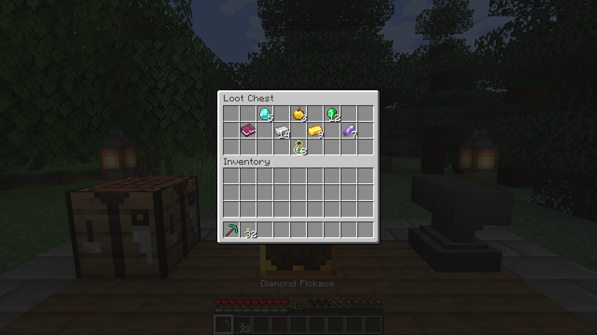
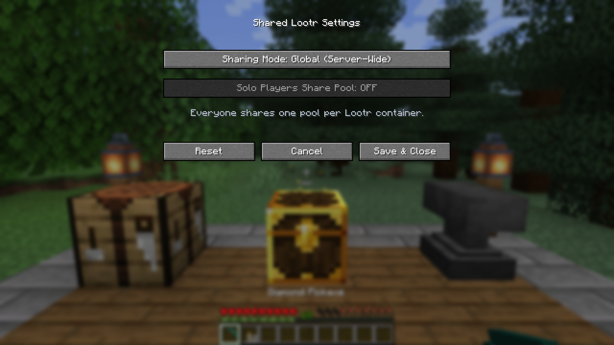

<!-- PROJECT_PAGE_START -->
<p align="center">
  
</p>

<h1 align="center">Shared Lootr</h1>

**Shared Lootr** keeps the best parts of [Lootr](https://modrinth.com/mod/lootr) — chest break protection, golden unopened highlights, advancements, and refresh/decay timers — without multiplying dungeon loot by player count on multiplayer servers. Instead of generating a separate chest copy for every player who walks by, each Lootr container shares a single inventory across the whole server (`GLOBAL`) or within each team (`TEAMS`).



---

### Sharing Modes (`config/shared_lootr.toml`)

- **`GLOBAL` (Default)** — Everyone on the server shares the same loot inside each Lootr container. Once someone opens and loots a chest, its contents and opened visual state update for everyone else.
- **`TEAMS`** — Teammates share one chest inventory together, while separate teams still get independent loot:
  - Automatically detects **FTB Teams** parties and server teams when FTB Teams is installed (optional).
  - Falls back to vanilla `/team` scoreboard teams when FTB Teams is not used.
  - Players who aren't in a team keep their own private loot by default (`soloPlayersSharePool = false`), or can share one common pool (`soloPlayersSharePool = true`).



Change modes anytime in-game via **Mod Menu** (Fabric) or **Mods → Config** (Forge / NeoForge), or by editing `config/shared_lootr.toml`.

### Supported Versions

Requires **[Lootr](https://modrinth.com/mod/lootr)**.

| Minecraft | Fabric | Forge | NeoForge | Lootr Version |
| :--- | :---: | :---: | :---: | :--- |
| `26.3` | ✅ | — | ✅ | `1.25.42+` |
| `26.2` | ✅ | — | ✅ | `1.24.41+` |
| `26.1.2` | ✅ | — | ✅ | `1.23.38+` |
| `1.21.1` | ✅ | — | ✅ | `1.11.38+` |
| `1.20.1` | ✅ | ✅ | — | `0.7.35+` |

### Credits

Thanks to **noobanidus** (author of [Lootr](https://github.com/LootrMinecraft/Lootr)) for adding official team-resolution hooks in modern Lootr releases.

<!-- PROJECT_PAGE_END -->

---

### Building

```bash
./scripts/setup-hooks.sh
./scripts/verify.sh [--container]
```
