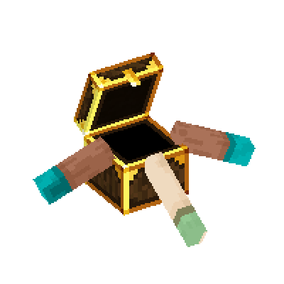

# Shared Lootr

<p align="center"></p>

Play Lootr, but share the loot.

<!-- PROJECT_PAGE_START -->

I really like the many improvements Lootr makes to loot chests: distinguishing them from ordinary chests, marking whether they have been opened, tracking how many loot containers have been opened, unique trophies, and more. But the one thing I don't like is that it gives every player their own loot container. I think sharing or competing for loot is a big part of the fun of adventuring in Minecraft, so I made this mod for my own private modpack.

## Requirements

Install the following mods as dependencies:

- Lootr
- RinLib

<!-- PROJECT_PAGE_END -->

---

## Additional technical details

# Shared Lootr

Shared Lootr is a thin compatibility layer for Lootr. Lootr remains the sole owner of container conversion, block entities, menus, renderers, models, textures, particles, packets, and persistence; this project changes only inventory ownership from per-player to one shared inventory per container.

## Behavior

- Lootr converts supported generated chests, trapped chests, barrels, shulker boxes, minecarts, and tagged custom inventories through its native paths.
- Every player sees and modifies the same inventory for a given Lootr container.
- The existence of that shared inventory is the server-side source of truth for generated loot, the persistent opened appearance, and Jade's generated-loot state.
- Lootr's native block events and NBT carry that state to clients; Shared Lootr defines no packet or second server-side opened-state rule.
- Lootr's native conversion still turns each half of a vanilla double chest into a separate single Lootr chest.
- No vanilla container mixin, custom block entity, renderer, model, texture, particle, or packet is provided here.

## Incompatible upgrade

Shared Lootr 1.2.0 does not migrate per-player inventories created by Lootr or Shared Lootr 1.1.x. When 1.2.0 is installed in an existing world:

- Existing player-owned inventory entries remain stored but are not used.
- The first player to open each affected container creates a new shared inventory from its loot table.
- As a result, previously collected loot can become available again.

## Compatibility target

- Minecraft `1.21.1`
- NeoForge `21.1.248`
- Lootr `1.21.1-1.11.37.122`
- Java `21`

## Build

```bash
./gradlew :neoforge:build
```

The NeoForge artifact is written to `neoforge/build/libs/`.
